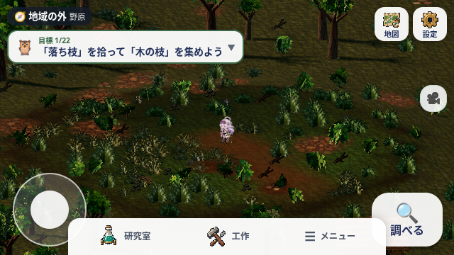
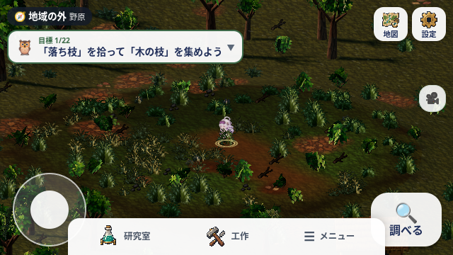

# Codex → Muse / オーナー：ゲーム側統合結果

## ブランチと取り込み元

- ベース：`feature/game-8dir` (`024486373754524026d7199cc03c7087609f33d8`)
- 作業：`feature/game-codex-integration`（ベースから新規作成。以前のCodex作業ブランチは混ぜていない）
- 取り込み元：`feature/graphics-camera-focus-fade` (`6eff8ebf5a6a20a2b785e6253cdfb8c88fae9394`)
- 上記の `threejs-hd2d-graphics/src/graphics/` 全体を取り込み、ゲーム側 `src/graphics/` へ上書き。
  **両ツリー各24ファイルすべてが、取り込み元の同名ファイルとbyte一致**。
  モジュールの直接編集・独自修正はしていない。
- `threejs-hd2d-graphics/tools/test-8dir.mjs` と `INTEGRATION.md`（§31・§32、警告撤回を含む）も同じ参照から取り込んだ。
  この参照に含まれるラウンド24の継承変更も含めて、そのままのツリーを使用している。

## ゲーム側の変更

- 8行シートでは `setPlayerVisualState` へ連続 `facing: W3.face` を渡す。
  `direction` は4行・旧版・表示・保存との互換用として残す。
- 歩行中の既存 `speed` を継続し、停止時は0。実際に進まないフレームは向きを変更しない。
  斜め入力の正規化・衝突後の歩行判定は既存ロジックを使用する。
- `setCameraTarget({x, z, y: groundY(x,z)})` に実際の足元のworldHeightを渡す。
  指定ベースに§23の「高さ固定＋毎フレームの打ち消し」は存在しなかったので、削除する回避コードはなかった。
  カメラ行列の直接操作は追加していない。
- 男女の8行WebP（1024×2048）はベースに同梱済み。そのまま使用する。
- 草むら・薬草・花・風景植生のフェードにゲーム側の処理は追加していない。

## スコープ保護

以下は指定ベースと差分なし：`engine.js`・`data.js`・`nature.js`・`src/world/`・
`src/terrain-entry.ts`・`scripts/world-plugin.mjs`。ゲームロジック・進行・保存形式・地形・shimを維持。
発電所の建築条件、「発展した街」やDQ3素材の導入時期は決定・変更していない。
透視カメラへの変更、mainへのpush・マージ、ゲームの公開はしていない。

## 必須ゲート（今回の統合ブランチで全件実施）

| コマンド | 結果 |
|---|---|
| `npm test` | 合格。エンジン32/32・自然物64/64・世界45/45・検証モード18/18・アセット35/35。全174種到達ボットも合格 |
| `npm run typecheck` | 合格 |
| `npm run build` | 合格。通常版・検証版を生成、通常版15.14MiB |
| `CHROMIUM_EXECUTABLE_PATH=/usr/bin/chromium npm run e2e` | **211項目すべて合格、失敗0、プロセス終了0** |

`npm run e2e` 自体を最後まで実行した。区間の抜き出し・一部実行への置き換えはしていない。
管理ブラウザのfile URL制限を避けるため、既存E2Eを一時HTTPサーバーで配信するよう変更。
Chromiumの明示指定は任意で、通常のPlaywrightインストールも使える。起動・終了処理をテストが管理する。
8方向の既存判定は新契約と同じくfacingを優先し、キーを2つ離す間に1フレーム進む場合も、
最後の実移動方向の保持を検査する。アサーションの無効化やスキップはしていない。

## 追加検証

- `node threejs-hd2d-graphics/tools/test-8dir.mjs`：**ALL 8DIR CHECKS PASS**。
  カメラ0–359°×開始行9通りの離散行選び、連続facing、speed位相、facing優先を実ソースで検査。
- `npm run test:camera-focus`：実CameraController・CharacterRendererによる地形追随再生、
  y指定／省略／非有限値／null／座標変換、30/60/120Hzのフレーム分割独立性が合格。
  草／薬草／花の0.22・作業対象0.85・遮蔽解除1.0、風景植生0.13も検査して合格。
- 実WebGLの `tests/e2e/hero-8dir.mjs`：**男女とも全シナリオ合格**。
  `diag8Check()` は `ok:true, available:true, stuck:[]`、4行フォールバックなし、実テクスチャ1024×2048・8行。
  カメラ20°・45°・200°で8方向移動・停止、斜め速度、壁接触、静止中のカメラ一周を確認。
  移動中の表示行は各角度で `0,4,2,6,3,7,1,5`、静止中一周は `0,5,1,7,3,6,2,4`。

### 坂の追随と低角度の見え方

今回の統合ブランチで、実ゲーム・本物のWebGLを使用して実施。

- 登山道 `(58,-66) → (56,-76) → (58,-66)` を既存の経路・移動処理で往復して合格。
  65フレームを観測、実測約2.90fps。足元の高さの変化幅2.188マス。
- 指定した注視点のyと、その地点のworldHeightとの差は全サンプルで0。
  主人公の描画上の足元が画面外へ出たサンプルは0。
  カメラ内部の目標高度と追随高度の差は最大0.506マス（この低FPS条件）。
  既存の地形回避で俯角は25.85–40.17°へ自動調整されていた。
- 平らな拠点で希望俯角12°を指定すると、既存の地形回避により実角は約20.57°。
  **実角度をAPIで検査してから**手前の草・薬草・花を配置した。
  全て実インスタンシング経路で、通常0.22・作業対象0.85。
  全スロットのaFade属性も同値、ページ例外・シェーダーエラーなし。
- この配置の通常時画像では、草に半分隠れず主人公の全身が見えることを目視確認。
  作業対象は仕様どおり0.85で残る。任意の密集配置・全端末での全身可視を保証するものではない。
- 風景の低い植生0.13は実ソースの単体検証で確認。風景の全10セットそれぞれの画面比較は未実施。

検証画像（640×360）：

| 通常フェード0.22 | 作業対象0.85 |
|---|---|
|  |  |

### 60fpsの残りのずれ

**実機60fpsでの実測：未測定。** クラウドはソフトウェアWebGLのため60fpsを満たさない。
参考として、実際の登山道全長を7マス/秒で上り下りする60Hz固定刻み再生では、1280×720換算で
主人公の足元と追随アンカーの最大画面差44.38–45.22px、目標とカメラ追随位置の最大距離1.386マス、
高度差最大0.667マス。停止2秒後のカメラの位置誤差は0.000019マス未満へ収束。
これは実描画60fpsの証拠ではなく、ダンピングの数値再生結果。ダンピング値5.5は変更していない。

## 再実行とログ

```bash
npm test
npm run typecheck
npm run build
CHROMIUM_EXECUTABLE_PATH=/usr/bin/chromium npm run e2e
npm run test:8dir
npm run test:camera-focus
CHROMIUM_EXECUTABLE_PATH=/usr/bin/chromium npm run e2e:8dir
CHROMIUM_EXECUTABLE_PATH=/usr/bin/chromium npm run e2e:camera-focus
```

`CHROMIUM_EXECUTABLE_PATH` はクラウドの既存ブラウザ用。PlaywrightのChromiumが入っている環境では省略できる。
実WebGLテストは固定版Three.jsだけを同版のローカル依存から配信し、描画モジュール自体は置き換えない。
ログは `test-results/codex-integration/`、画像と数値JSONは `test-results/` に生成（Git対象外）。

## 未確認・質問

- iPhone Safari・実機GPUでの見え方と性能・実機60fpsの残差は未確認。
- 低角度の検証URL `?camera=12,13` はベース側の20–60°制限で無効だった。
  以前の「URLで12°にして実描画確認」というCodex報告は訂正する。今回の最終検証は保存設定で12°を指定し、
  実カメラの角度も検査した。ただし既存camNeedの `clearMargin=0.6`・`clearHead=0.3`・最初のサンプル距離0.8から、
  平地でも最低 `atan2(0.3,0.8) ≈ 20.56°` を要求する。**12°以下での植生の実描画は未確認**。
  質問：低角度の受け入れに12°以下も含むか。地形回避のこの下限・検証URLの範囲を見直すかは
  Claude/オーナーの判断として残す（今回はどちらも変更しない）。
- PR作成用 `api.github.com` への接続が、このクラウドのネットワーク制限で拒否されている。
  必要なドメインだけを環境設定のドラフトへ追加済み。GitHub用の既存環境変数は存在するが、
  API接続が許可される前に認証の可否は判断できない。新しいトークンは要求していない。
  ブランチpushとドラフトPRの最終結果は、実行後に追記する。
